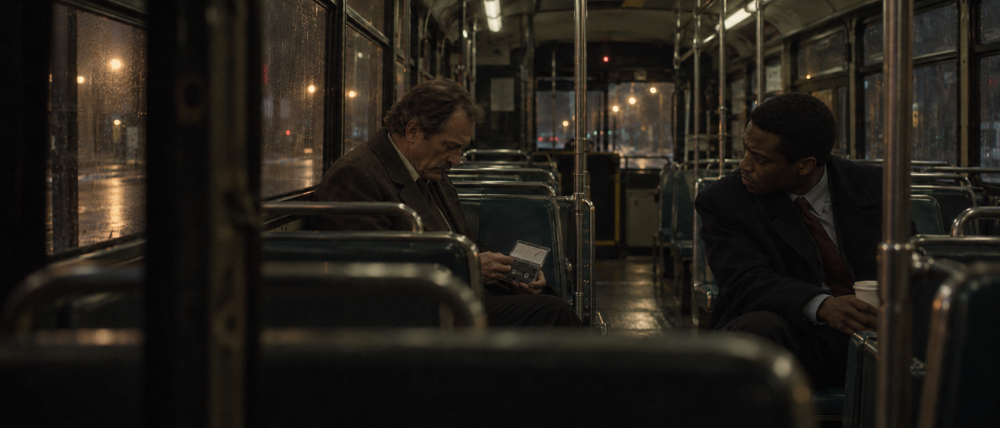
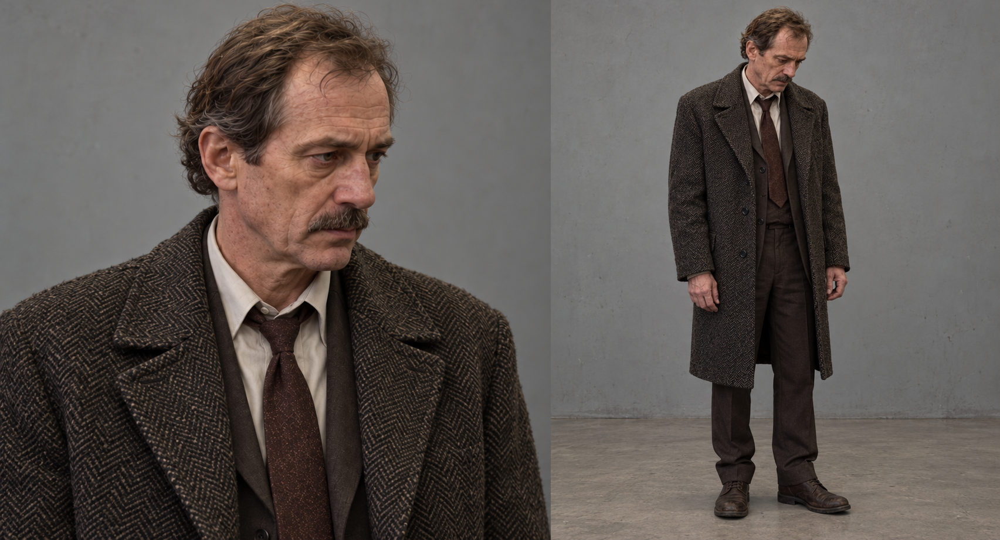
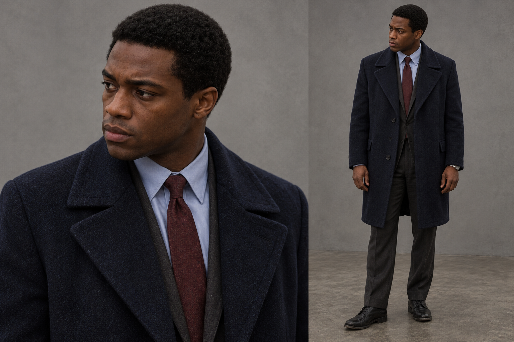
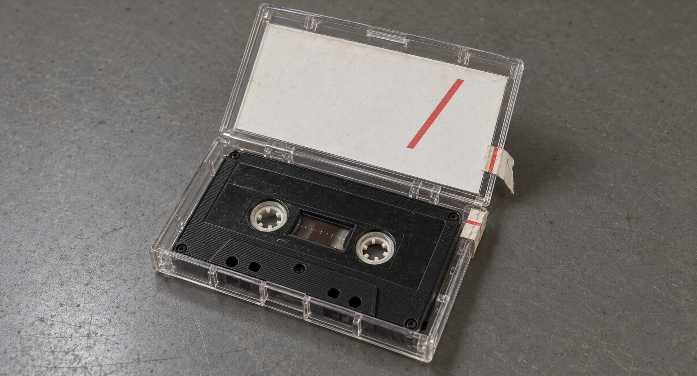
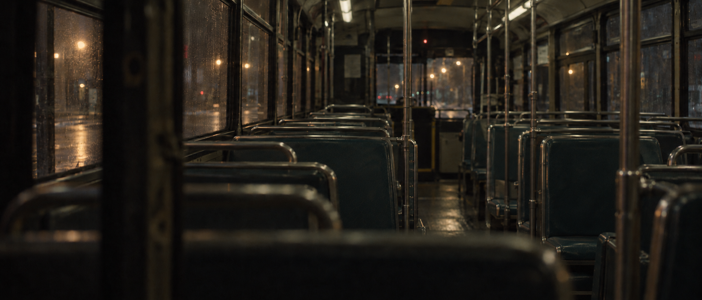
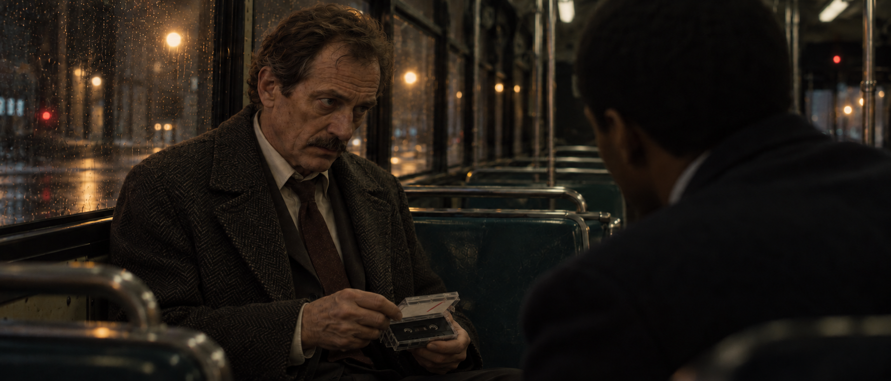
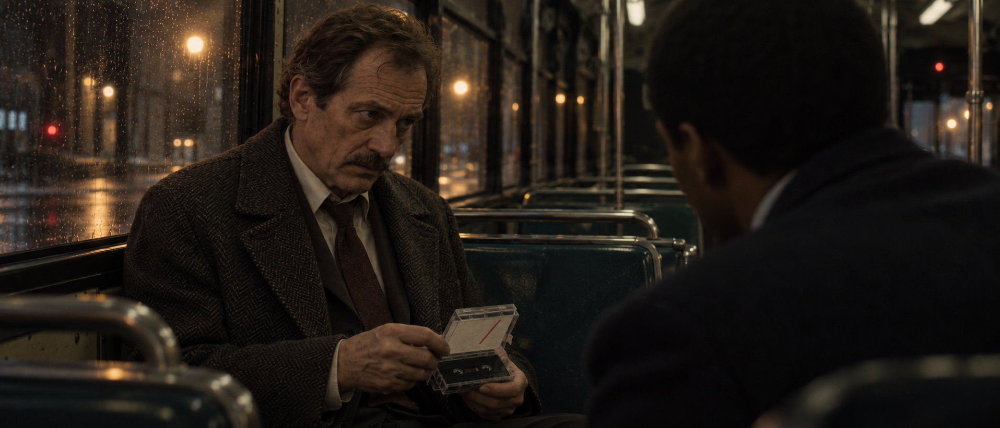
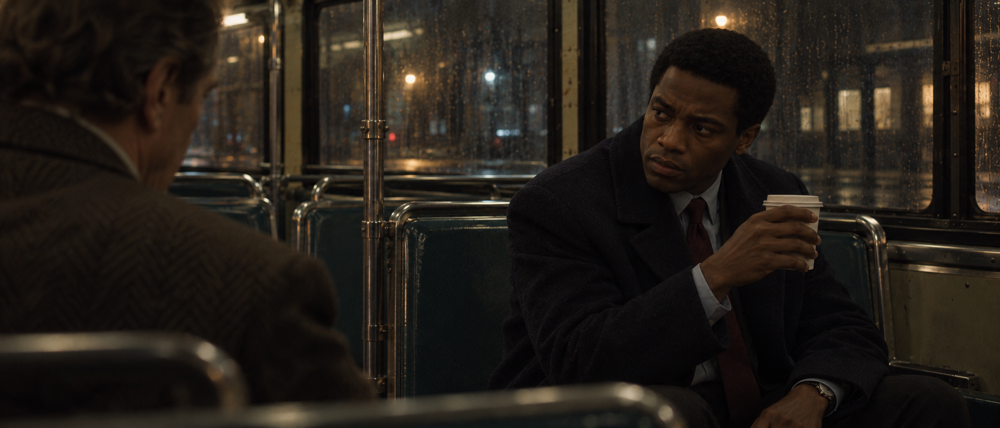
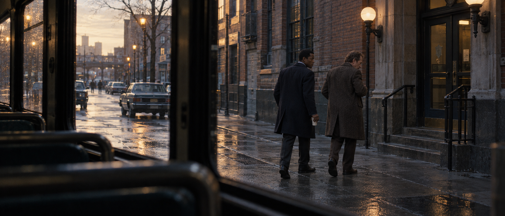

# 《末班证词》：从画面到后续镜头

本例是原创的 1987 年纽约双侦探故事，用来试作视觉资产包。图片均通过内置 ImageGen 实际生成；工具没有披露底层模型版本。用户在影调校准后允许继续，随后对三镜与候选功能包回复“可以没问题”。这一认可支持本组结果继续使用，不认证全部几何、年代细节或逐像素连续性。

## 这场戏

唯一的线人失踪。两名侦探带着从证物室取回的录音带，坐夜班公交返程。盒上的记号异常，让他们意识到警局内部可能有人动过证物。

M02r1：老侦探仍在看盒子，年轻搭档已经看向他。此图先作为继续采用的影调方向，后续镜头围绕不同注意力与当前动作展开。

## 先纠正视觉方向

初版把人物、衣着、证物和湿玻璃交代得过满。用户否定影调和风格，提供六张自己此前制作的画面作为参考；原始六图未复制进本仓库。实际观察归纳为：

- 从货架、门框、玻璃或家具后观察，观看位置属于场景。
- 动作、目光和站坐关系承担叙事，环境不为展示人物而清空。
- 实际光源只照到必要区域；暗部、低中间调和局部明亮可以共存。
- 色温跟随光源：灰绿室内、暖日落、冷窗口与暖桌灯是不同条件，不使用统一绿滤镜。
- 柔和边缘、克制的局部反差和细颗粒共同影响影像反应；不反推真实摄影机或胶片型号。
- 正式叙事宽景不必把每个道具标记都展示清楚；清晰的结构参考有自己的用途。

这些属于本例的视觉选择。新功能不把复古、纽约、暗调、遮挡或宽画幅设为所有创作的默认。

## 资产各自控制什么

| 素材 | 本例用途 | 不接管的内容 |
| --- | --- | --- |
| M02r1 母版 | 人物关系、故事状态与本例影调方向 | 新机位下看不到的完整空间 |
| A01 / A02 人物页 | 人物身份与服装的主要结构 | 中性背景、站姿、工作光及展示锐度 |
| P01 证物页 | 透明盒、白卡红斜线、黑磁带、封签相对位置 | 桌面、背景、照明；本镜允许改变的开合状态 |
| L02 空车厢 | 当前母版可见的布局、材质与局部光源 | 被遮挡区域的测绘真实性 |

查看本例复用的人物与证物参考页

参考页的清楚展示不意味着正式镜头必须采用同样背景、亮度和锐度。未在原母版中展示的鞋、完整身材比例或衣长属于补充设计。

L02 从当前母版移除人物与随身物品；原本被身体挡住的座面是生成补全。单张图及其空景不等于精确三维场景。

## 接三个镜头

### S11r1：抬眼，盒盖尚未合上

从搭档一侧观察。老侦探抬眼看向对方，手上的盒盖正在合拢，物件仍留在他们的关系里。

最初 S11 的盒盖仍较竖立，未明确表现原计划半合状态。局部修复只降低盒盖，并调整必要的指尖接触；目视检查中，人物、机位、前景和光区延续。没有认证精确角度或逐像素不变。

查看实际修复前图

### S12：杯子停在半途

镜头意图是日常动作被理解打断。右手的杯子已举起、尚未喝下；左腕手表和主要服装特征仍可见，目光对向老侦探。近景允许更多细节出现，既有角色参考不因此成为肖像光线的依据。

### S13：黎明返回警局

这里有意省略时间，切到黎明。摄影机留在车内，座椅与窗框保留观看距离，人物回到街景中。纸杯仍由年轻搭档右手持有。

证物按计划已收进老侦探内袋，内部状态无法由画面认证。外景为新设计，具体街区、车辆和建筑的 1987 年准确性未独立考据；这些限制没有被当作已通过的连续性检查。

## 实际输入与结果边界

[本轮完整 Prompt 与参考职责](last-bus-testimony-prompts.json)保留了空景、三镜与一次修复的实际指令。原始六张作者风格图未在公开包中提供，需要新鲜图像级迁移时仍要重新附上可访问原图。文字规则和图片标题不能代替实际图像。

本例走通了影调纠正、必要资产准备、按职责编译、后续生成、检查和局部修复。中性人物/证物页被复用，影调改变没有要求重新生成全部结构资产。用户认可本组结果可继续使用。

这是一段定性工作流，不是受控新旧版或有/无资产比较，不能据此宣称普遍提高质量、保证一致性或节省多少成本。文字前向试用另见[行为记录](behavior-check-v2.6.md)，文件与发布状态见[验证记录](validation-v2.6.md)。

**English:** This actual prototype separates role-scoped references from narrative look, corrects the direction after user feedback, and continues through a close view, reverse and dawn exterior. The user confirmed the set usable. Prop-state repair, inferred geometry and unseen contents remain explicitly bounded. It is qualitative evidence, not a controlled claim of general improvement. Original author look references are not redistributed here.

[返回首页](../README.md) · [Asset Pack 工作流](../zy-cinematic-realism/references/asset-pack.md)
